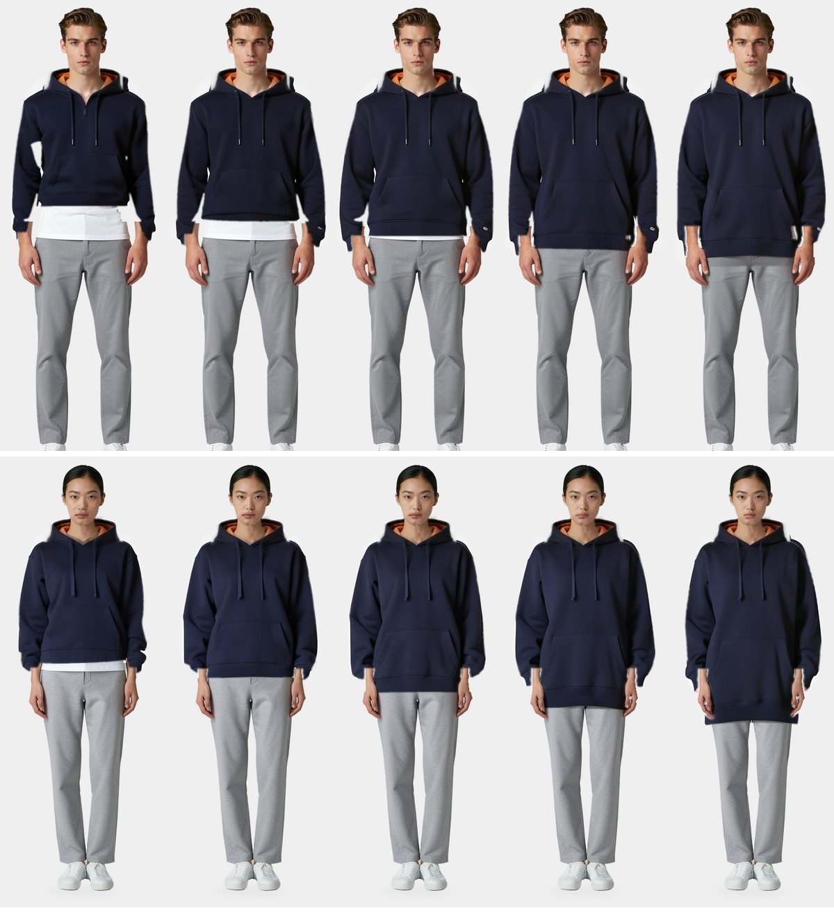

# OPEN LATE

Gender-neutral basics with the comfort of a sign still lit late at night.

Open models and scripts run the work from design to operations. People approve decisions and deal with the sample room and factories.



*Virtual models, AI-generated images. One pattern in five sizes, draped in 3D before an image model repaints the garment. This is an experiment, not yet in production.*

## What's inside

- **Pipeline:** 16 nodes from brief to trademark watch, with approval gates and a full history.
- **Patterns:** FreeSewing drafts exported as 1:1 SVG and DXF, with automated checks.
- **Fitting room:** starts from fit preference, answers with two sizes, and describes the fit in words.
- **Draping:** a cloth solver on the Mac GPU that sews the pattern onto a fitted body.

## Run

Requires Docker and an Apple Silicon Mac.

```bash
cp .env.example .env
make up               # console, pattern, worker, MLflow
make gateway          # text and vision model, about 20 GB on first run
host/fitting/run.sh   # image models, 15 GB for try-on and 31 GB for portraits
```

| Service | Address |
|---|---|
| Console | http://localhost:7100 |
| Fitting room | http://localhost:7100/fitting |
| Fit QA | http://localhost:7100/fitting/qa |
| Pattern | http://localhost:7110/designs |
| Worker | http://localhost:7120/health |
| MLflow | http://localhost:5060 |

Models run on the host because Docker on macOS cannot reach the Metal GPU.

## Layout

```
pipeline/      node definitions and prompts
stacks/        console, pattern, worker and observability (Docker)
host/          model gateway and render engine (native)
experiments/   evaluations with their results
docs/          architecture and pipeline review
research/      model and training lab (submodule)
```

## Status

Early prototype, for local use only: the services have no authentication.

- Runners exist for pattern generation and colorways. The other nodes are defined but not built.
- The size chart is a placeholder until real body data replaces it.
- Size comparison uses numbers. The draped images are not in the fitting room yet.

Read [the architecture](docs/architecture.md) and [the pipeline review](docs/review.md) for the reasoning.
