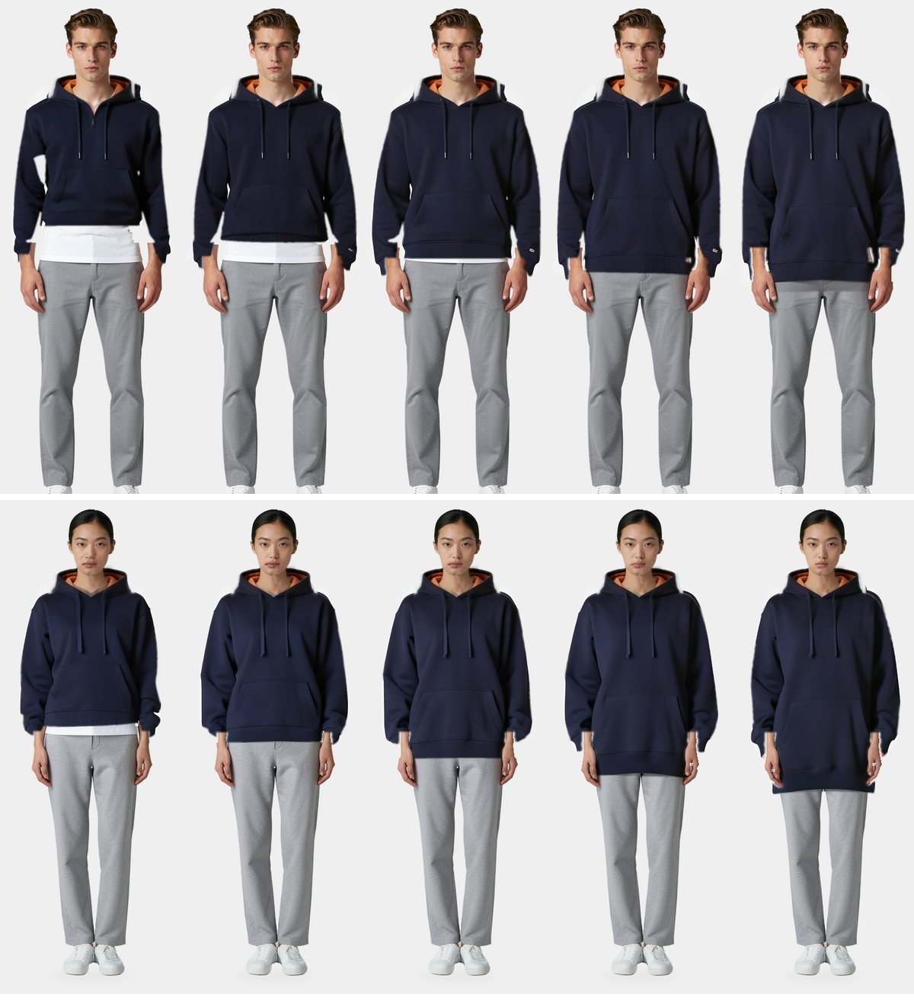

# 04: Draped geometry

Can a size ladder show the pattern's real length if the image model starts from draped geometry instead of a sentence?

Virtual models, AI-generated images. Bake-off only: the fitting room still compares sizes by numbers.

## Pipeline

1. `panels.mjs` flattens the FreeSewing Hugo parts into polylines, one set per size.
2. `body.py` fits the open Anny body model to a size chart row and poses it like the portrait. It uses the default topology,
   whose assets are CC0. The optional SMPL-X topology is non-commercial and is not used.
3. `drape.py` meshes the panels and solves them on the Mac GPU with MLX. Panels start wrapped around the arms-out body, seam
   pairs pull them closed, gravity settles the cloth, and the arms come down to the portrait pose.
4. `guide.py` renders the mesh with its pattern coordinates, so pocket, rib and seams land where the pattern puts them. FLUX.2
   klein then repaints the garment by image-to-image. Face, hands and legs stay the original pixels.

`proxy.py` came first: it stretched an existing render to test step 4 before any solver existed. `view.py` draws debug views.

## Results (2026-11-01)

Ten drapes: two bodies, sizes XS to XL, Ink navy × Apricot, seed 42. Hem is measured in the middle 100 columns of the image.

| Measure | Man, 175 cm | Woman, 160 cm |
|---|---|---|
| Hem travel, XS to XL, plain prompt (production) | 6.9 cm | 7.5 cm |
| Hem travel, XS to XL, numeric prompt (experiment 03) | 2.3 cm | 1.9 cm |
| Hem travel, XS to XL, simulation | 19.1 cm | 20.1 cm |
| Hem travel, XS to XL, final image | 19.2 cm | 22.0 cm |
| Largest image error against the simulation | 0.6 cm | 1.3 cm |
| Neck-to-hem change, simulation, against 15.9 cm in the pattern | 16.5 cm | 16.4 cm |

Timing on an M4 Max: 17 s per drape at about 6,800 vertices, 11 s per image.

What this shows:

- Geometry carries length where sentences do not. Nine of ten images are within 1.0 cm of the simulation; the woman in XL is
  1.3 cm off, and her total travel is 1.9 cm over the simulation's.
- The planned gate of 15.9 ± 1 cm of hem travel was the wrong test. The pattern changes length by 15.9 cm, but a worn hem moves
  further, because small sizes ride up over the chest and large sizes sit lower at the neck. Images are judged against the
  simulation. The neck-to-hem change is the check on the pattern, and it is within 0.6 cm.
- Absolute hem heights are unverified. A wear test on the real sample is still needed.
- `HPS = 0.82` of height, used in experiment 03 and `proxy.py`, is too low. The neck edge rests at about 0.86 of height on the
  fitted man, and the simulation puts his size M hem about 8 cm above that estimate. Do not reuse it.
- Image-to-image needs `Flux2Klein`. `Flux2KleinEdit` accepts `image_strength` but starts from noise, and the result is garbage.

## Known defects

Not ready for customers.

- The model still adds detail the pattern lacks: a short zip on the man's XS and small tags on his cuffs.
- White fringes remain along some sleeves and the hood, and t-shirt patches remain beside the man's arms in small sizes.
- Wrists are rough where the sleeve meets the original hand.
- The hood is not simulated. It comes from an existing size L render, so it does not change with size.
- Fitted bodies miss the chart: chest 871 against 925 mm and 994 against 1105 mm. Height is within 10 mm.
- There is no cloth self-collision and no back view. Stiffness values are hand-set, not measured from fabric.
- The neck edge needs stretch-only ties to stay on the shoulders. They stand in for the neck binding and the hood.

## Why our own solver

The GarmentCode Warp fork is non-commercial. Upstream Warp 1.18 has dropped its cloth module and has no Metal backend.

## Run

    # from a folder with the stacks/pattern dependencies installed
    node panels.mjs                       # writes panels.json

    uv venv --python 3.12 .venv
    uv pip install --python .venv/bin/python anny==0.6.2 mlx==0.32.4 pysdf==0.1.9 torch==2.15.0 trimesh==5.2.0 scipy==1.18.1
    .venv/bin/python body.py m-M-white f-S-east_asian
    .venv/bin/python drape.py m-M-white M panels.json     # once per person and size

    # needs the renders from experiment 03; render engine stopped
    host/fitting/.venv/bin/python guide.py m-M-white L panels.json XS S M L XL

Everything is written under `data/fitting/bakeoff/draped`. Production portraits and try-ons are read, never changed.
